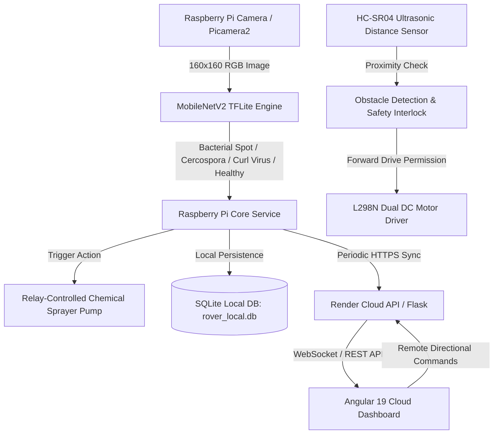

# Plant Disease Detection AI – Precision Agriculture Smart Rover
### Autonomous Edge AI Disease Diagnosis, Collision Avoidance, and Targeted Chemical Sprayer System

[](https://www.tensorflow.org/lite)
[](https://angular.dev/)
[](https://palletsprojects.com/p/flask/)
[](https://www.raspberrypi.com/)
[](LICENSE)

---

## 🌾 Project Overview

The **Plant Disease Detection AI – Precision Agriculture Smart Rover** is a complete, cyber-physical robotics and AI system engineered for precision horticulture. The rover traverses chili crop fields, captures leaf imagery via the Raspberry Pi camera module, performs real-time edge inference using an optimized **MobileNetV2 TensorFlow Lite model (96.01% test accuracy)** across 4 categories, enforces ultrasonic obstacle safety interlocks, and actuates a targeted chemical sprayer pump with operator confirmation.

The system connects to a cloud-synced **Angular 19 responsive dashboard** hosted on Render, allowing farmers and researchers to monitor plant health and control the rover from Android phones, laptops, and workstations anywhere in the world.

---

## 🚜 System Architecture



---

## 🎯 4-Class Leaf Disease Classification

| Category | Causal Pathogen | Verified Test Accuracy | Standard Field Treatment (India) |
| :--- | :--- | :---: | :--- |
| **Bacterial Spot** | *Xanthomonas campestris* | **96.5% F1** | Copper Oxychloride 50% WP (2.5 g/L) + Streptocycline (1 g/10 L) |
| **Cercospora Leaf Spot** | *Cercospora capsici* | **97.4% F1** | Mancozeb 75% WP (2.5 g/L) OR Chlorothalonil 75% WP (2.0 g/L) |
| **Curl Virus** | *Begomovirus* (Whitefly Vector) | **94.7% F1** | Whitefly vector control: Neem Oil (3-5 ml/L) OR Diafenthiuron 50% WP (1.2 g/L). Roguing infected plants. |
| **Healthy Leaf** | None (Optimal Crop Health) | **95.3% F1** | No chemicals needed. Continue standard nutrition and irrigation. |

- **Overall Validated Model Test Accuracy**: **96.01%** (Macro F1: 0.9596)
- **Dataset Size**: **6,764 total curated images**

---

## 📁 Repository Directory Structure

```text
Plant_Disease_Detection_AI/
├── AI_Model/
│   ├── best_chili_leaf_model.keras   # Original trained MobileNetV2 Keras model (20.78 MB)
│   ├── model.tflite                  # Optimized edge TFLite model (8.49 MB)
│   ├── class_names.json              # Class index mapping
│   └── Reports/                      # Training graphs, confusion matrix, JSON reports
├── Dataset/                          # Symbolic links to verified 6,764 images
├── Raspberry_Pi/                     # Local edge software for Raspberry Pi 4B
│   ├── main.py                       # Core Flask API & orchestration service
│   ├── camera.py                     # Automatic libcamera / Picamera2 driver
│   ├── inference.py                  # LiteRT / TFLite classification engine
│   ├── motor_driver.py               # Low-level L298N H-Bridge dual motor control
│   ├── rover_control.py              # Steering commands, watchdog, and interlocks
│   ├── ultrasonic_sensor.py          # HC-SR04 pulse measurement with noise filtering
│   ├── obstacle_detection.py         # 25 cm safety buffer & critical stop logic
│   ├── sensor_manager.py             # Modular telemetry collector
│   ├── sprayer_control.py            # Relay actuation with explicit confirmation
│   ├── database.py                   # Local SQLite persistence & queue
│   ├── sync_service.py               # Background cloud synchronization
│   ├── config.py                     # Centralized hardware configuration
│   └── requirements.txt              # Edge Python dependencies
├── Website/
│   ├── backend/                      # Cloud Flask API (Render Web Service)
│   │   ├── app.py
│   │   └── requirements.txt
│   └── frontend/                     # Angular 19 responsive dashboard (Render Static Site)
│       ├── src/
│       ├── angular.json
│       └── package.json
├── Documentation/
│   ├── API_DOCUMENTATION.md          # REST API specifications
│   └── HARDWARE_WIRING_GUIDE.md      # GPIO pinout & voltage divider schematic
├── render.yaml                       # 1-Click Render blueprint deployment file
├── .env.example                      # Configuration template
└── README.md
```

---

## ⚡ Quick Start Guide

### 1. Raspberry Pi Local Setup
```bash
# Navigate to project
cd ~/Plant_Disease_Detection_AI

# Create virtual environment and activate
python3 -m venv venv --system-site-packages
source venv/bin/activate

# Install requirements
pip install -r Raspberry_Pi/requirements.txt

# Start core rover service
cd Raspberry_Pi
python3 main.py
```

### 2. Angular Website Local Development
```bash
cd ~/Plant_Disease_Detection_AI/Website/frontend
npm install
npm run build
npm start
# Open http://localhost:4200 in your browser
```

### 3. Deploy to Render
The repository includes a ready-to-deploy [`render.yaml`](render.yaml) blueprint:
1. Push your repository to GitHub.
2. In Render Dashboard, click **New > Blueprint**.
3. Select your repository. Render will automatically deploy:
   - **Cloud Flask Web Service**: `https://<your-service-name>.onrender.com`
   - **Angular Static Site**: `https://<your-site-name>.onrender.com`

---

## 🛡️ Safety & Interlocks

- **3.3V Logic Protection**: HC-SR04 ECHO pin produces 5V. A voltage divider (1kΩ / 2kΩ resistors) is strictly required between ECHO and GPIO.
- **Collision Override**: If an obstacle is detected within 25 cm, forward drive commands are strictly blocked.
- **Chemical Safety**: The sprayer pump requires explicit operator confirmation and enforces a hard cutoff timeout (default: 3 seconds, max: 10 seconds).
- **Runaway Watchdog**: If WiFi drops during manual driving, rover motors stop automatically within 1.5 seconds.
